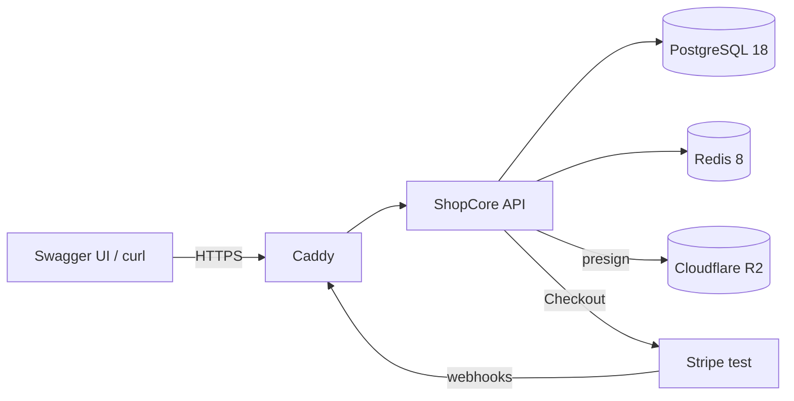
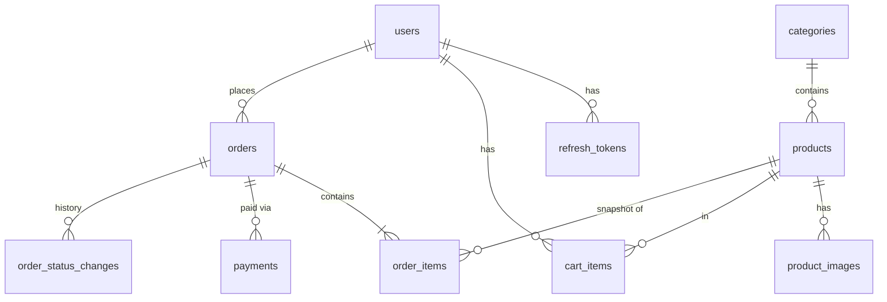
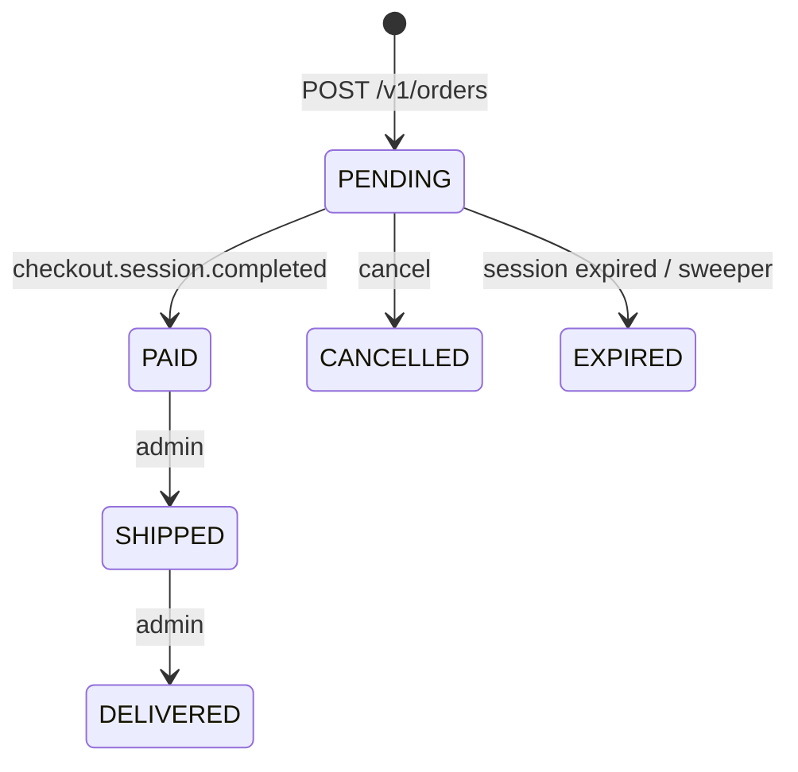

# ShopCore API


Production-style e-commerce REST API: NestJS 12, Prisma 7, PostgreSQL 18, Redis 8, Stripe Checkout (test mode), Cloudflare R2.

Live Swagger: `https://shopcore-api.<domain>/docs`

## Demo

| Role     | Email                  | Password           |
| -------- | ---------------------- | ------------------ |
| Admin    | `admin@example.com`    | `DemoAdmin123!`    |
| Customer | `customer@example.com` | `DemoCustomer123!` |

Stripe test card: `4242 4242 4242 4242`, any future expiry, any CVC.

Public `GET /v1/demo` repeats these credentials when `DEMO_MODE=true`. Nightly reset at 03:00 UTC.

### 2-minute walkthrough

1. Open `/docs` and authorize as the demo customer.
2. `GET /v1/products` — browse the seeded catalog.
3. `PUT /v1/cart/items/{productId}` with `{ "quantity": 1 }`.
4. `POST /v1/orders` with a shipping address.
5. `POST /v1/orders/{id}/checkout` and open `checkoutUrl`.
6. Pay with the test card. The webhook marks the order `PAID`.

## Architecture







## Stack

Node 24, pnpm 12, NestJS 12, Prisma **7.10.0**, PostgreSQL 18, Redis 8, Zod 4, Stripe test Checkout, Cloudflare R2, Resend (optional).

Money is integer minor units (`USD` cents). Errors are RFC 9457 `application/problem+json`.

## Getting started

```bash
pnpm install
docker compose up -d postgres redis   # or local Postgres 18 + Redis 8
cp .env.example .env                 # generate JWT_ACCESS_SECRET; use sk_test_ keys only
pnpm db:generate && pnpm db:migrate && pnpm db:seed
pnpm seed:images:generate
pnpm dev                             # http://localhost:3000/docs
pnpm stripe:listen                   # webhook forwarding
```

`pnpm typecheck && pnpm lint && pnpm format:check && pnpm build`

## Environment

See `.env.example`. Live Stripe keys (`sk_live_` / `rk_live_`) are rejected at boot.

## Screenshots

| File                                                         | What                    |
| ------------------------------------------------------------ | ----------------------- |
| [docs/screenshots/swagger.png](docs/screenshots/swagger.png) | `/docs` with Authorize  |
| [docs/screenshots/demo.png](docs/screenshots/demo.png)       | `GET /v1/demo`          |
| [docs/screenshots/catalog.png](docs/screenshots/catalog.png) | Product list JSON       |
| [docs/screenshots/stats.png](docs/screenshots/stats.png)     | Admin summary + revenue |
| [docs/screenshots/problem.png](docs/screenshots/problem.png) | RFC 9457 `problem+json` |

`checkout.png` and `order-paid.png` need a real Stripe test key + webhook (`pnpm stripe:listen`).

## Deployment

- Multi-stage `Dockerfile`
- `docker-compose.prod.yml` (migrate → api, internal Postgres/Redis, external `proxy` network)
- `deploy/shopcore.caddy` for the shared Caddy proxy
- GitHub Actions: CI (lint, typecheck, build, Prisma validate, migration drift, Docker build) and optional GHCR + SSH deploy

First VPS seed: `docker compose -f docker-compose.prod.yml run --rm api node dist/database/seed/seed.cli.js`
