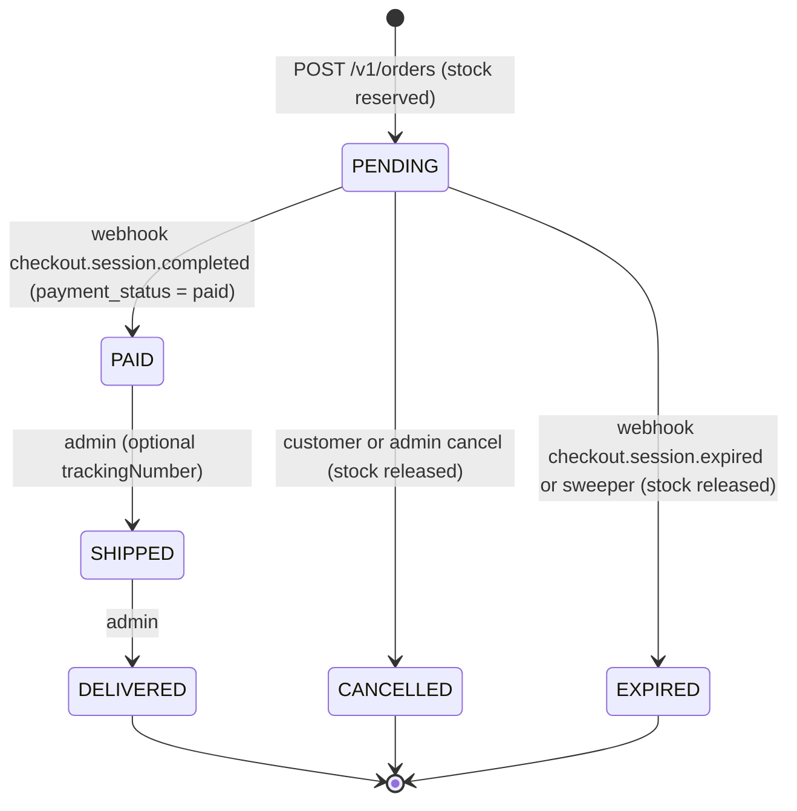

# ShopCore API — Product Specification

Status: approved for implementation · Version: 1.0 · Date: 2026-10-15

ShopCore is a production-style e-commerce REST API backend built as a public portfolio project. It ships with a live, abuse-resistant demo that any visitor can explore end to end from Swagger UI: browse a seeded catalog, fill a cart, place an order, pay with a Stripe test card, and watch the order move through its lifecycle as an admin.

Related documents: [ARCHITECTURE.md](./ARCHITECTURE.md) (technical design) · [PLAN.md](./PLAN.md) (implementation plan, decisions log).

---

## 1. Purpose — what this demo proves to clients

| Claim | Evidence in the project |
| --- | --- |
| Clean, modular backend architecture | NestJS 12 feature modules, strict TypeScript, no circular dependencies, thin controllers, mappers instead of leaking ORM entities |
| Secure authentication | argon2id hashing, short-lived JWT access tokens, rotating refresh tokens stored hashed with reuse detection, RBAC |
| Solid database design | PostgreSQL 18 + Prisma 7, normalized schema, money in minor units, price snapshots, CHECK constraints, trigram search indexes, order audit trail |
| Real payments integration | Stripe Checkout (test mode), signed webhooks verified on the raw body, idempotent event processing, reconciliation job |
| Correctness under concurrency | Stock reservation with atomic conditional updates — no overselling; conditional state transitions — no lost updates |
| Excellent API documentation | Public Swagger UI generated from Zod schemas, examples, demo credentials, RFC 9457 problem details for every error |
| Production readiness | Rate limiting (Redis), caching (Redis), health checks, structured logs with request IDs, graceful shutdown, security headers |
| DevOps | Multi-stage Docker image, Docker Compose (dev + prod), Caddy HTTPS, migrations on deploy, GitHub Actions CI + deploy |

## 2. Target client persona

**Primary — "Startup founder / product owner"** (Upwork, Fiverr; US/EU/UK/AU). Needs a backend for an online store, marketplace or D2C MVP. Technical enough to open Swagger and click "Try it out", not necessarily a developer. Decides in under 5 minutes based on: does the live demo work, does it look professional, does the README explain it clearly.

**Secondary — "Agency CTO / tech lead"** hiring a contractor for a NestJS backend. Reads the code on GitHub: module structure, transaction handling, webhook idempotency, error handling, CI. Looks for red flags (secrets in repo, `any` everywhere, no validation, no migrations).

Implications: the demo must work on the first try without registration; demo credentials are visible on the Swagger landing section; errors are self-explanatory; the code must be idiomatic and readable.

## 3. Feature list (MoSCoW)

### Must

- **M1 Auth**: register, login, refresh (rotation + reuse detection), logout, logout-all, `GET /v1/me`; roles `CUSTOMER` / `ADMIN`; argon2id.
- **M2 Profile**: update name, change password (revokes all sessions).
- **M3 Categories**: flat list (one level), public read, admin CRUD.
- **M4 Products**: public list with search, filters (category, price range, in stock), sorting, offset pagination; public detail by slug; admin CRUD with statuses `DRAFT` / `ACTIVE` / `ARCHIVED` (soft delete).
- **M5 Product images**: admin uploads directly to Cloudflare R2 via presigned PUT URL (type/size limits), then attaches; reorder, edit alt, delete.
- **M6 Cart**: server-side cart per user; set quantity, remove item, clear; live price and availability.
- **M7 Orders**: create from cart with price snapshot and stock reservation; list/detail own orders; cancel pending order.
- **M8 Payments**: Stripe Checkout session per order (test mode, pinned API version); webhook with signature verification on raw body; idempotent processing; `checkout.session.completed` and `checkout.session.expired`.
- **M9 Order lifecycle**: state machine `PENDING → PAID → SHIPPED → DELIVERED`, plus `CANCELLED` and `EXPIRED`; status history; expiry sweeper that releases stock.
- **M10 Admin orders**: list with filters, detail with history and payments, status transitions.
- **M11 Admin stats**: summary (revenue, orders, AOV, new customers, status breakdown), revenue by day, top products.
- **M12 Admin users**: list, detail, change role, block/unblock.
- **M13 API docs**: Swagger UI at `/docs`, OpenAPI JSON/YAML, bearer auth, examples, demo credentials in the description.
- **M14 Errors**: RFC 9457 `application/problem+json` everywhere, stable machine-readable `code`, `requestId`.
- **M15 Platform**: validation on every input, URI versioning `/v1`, Redis-backed rate limiting, Redis cache for catalog reads with invalidation on writes, security headers, CORS from env, health endpoints (DB + Redis), structured JSON logs with request IDs, graceful shutdown.
- **M16 Demo safety**: demo mode flag, protected demo accounts, nightly reset and re-seed, upload quotas and limits, demo caps, Stripe test keys enforced.
- **M17 Seeds**: 6 categories, 50 products with images, 2 demo accounts + 25 customers, ~200 historical orders over the last 90 days.
- **M18 Delivery**: multi-stage Dockerfile, dev and prod Compose files, Caddy site snippet, migrations applied on deploy, GitHub Actions CI (lint, typecheck, build, prisma validate, migration drift check, Docker build).

### Should

- **S1** Payment reconciliation in the expiry sweeper (marks orders paid if a webhook was missed).
- **S2** Automatic refund when a payment completes for an order that is no longer payable.
- **S3** `GET /problems/{slug}` documentation endpoint for every problem type.
- **S4** `GET /v1/demo` endpoint describing demo mode, credentials and next reset time.
- **S5** Image magic-byte verification on attach.
- **S6** Continuous deployment workflow (build → GHCR → SSH deploy).
- **S7** HTML success/cancel pages for Stripe Checkout redirects.

### Could

- **C1** Order confirmation email via Resend (allowlisted recipients in demo mode).
- **C2** `Idempotency-Key` support for `POST /v1/orders` (not planned in v1; noted for future).
- **C3** Scalar API reference as an alternative docs UI (not planned in v1).

### Won't (this version)

See §11 Out of scope.

## 4. API conventions

| Topic | Rule |
| --- | --- |
| Base URL | Production `https://shopcore-api.<domain>`; local `http://localhost:3000` |
| Versioning | URI versioning, all business routes under `/v1`. Version-neutral: `/`, `/health`, `/health/live`, `/docs*`, `/problems/{slug}` |
| Auth | `Authorization: Bearer <accessToken>`. Refresh tokens travel in the JSON body (never cookies) |
| Content type | Requests `application/json` (max 100 KB). Success responses `application/json`. Errors `application/problem+json` |
| Naming | JSON fields `camelCase`; enum values `UPPER_SNAKE`; query params `camelCase` |
| IDs | UUID v7 strings. Orders also have a human number `SC-000123` |
| Dates | ISO 8601 UTC with milliseconds, e.g. `2026-10-15T13:45:00.000Z`; date-only params `YYYY-MM-DD` (UTC) |
| Money | Integer minor units + ISO 4217 currency. Responses use `Money = { amount: number; currency: "USD"; formatted: "$49.99" }`. Inputs use `*Amount` integers. Floats are never accepted |
| Single resource | Returned bare (no envelope) |
| Lists | `{ data: T[] }` for small unpaginated lists; `{ data: T[], meta: PageMeta }` for paginated lists |
| Pagination | Offset: `page` (≥1, default 1), `limit` (1–100, default 20). `PageMeta = { page, limit, total, totalPages }` |
| Sorting | `sort` enum per endpoint, e.g. `newest`, `price_asc` |
| Unknown fields | Request bodies are strict: unknown keys → `400 VALIDATION_FAILED` |
| Request ID | `X-Request-Id` accepted (≤64 chars `[A-Za-z0-9_-]`) or generated; always echoed in the response header and in problem bodies |
| Rate-limit headers | `X-RateLimit-Limit`, `X-RateLimit-Remaining`, `X-RateLimit-Reset`; on 429 also `Retry-After` (seconds) |
| Ownership | Accessing another user's order/cart resource returns `404`, never `403` (no ID probing) |

### Shared schemas

```ts
type Money = { amount: number; currency: string; formatted: string };
type PageMeta = { page: number; limit: number; total: number; totalPages: number };
type Paginated<T> = { data: T[]; meta: PageMeta };

type UserProfile = { id: string; email: string; name: string; role: 'CUSTOMER' | 'ADMIN'; createdAt: string };
type AdminUser = UserProfile & { isBlocked: boolean; isProtected: boolean; ordersCount: number; updatedAt: string };

type TokenPair = {
  tokenType: 'Bearer';
  accessToken: string;          // JWT, 15 min
  accessTokenExpiresAt: string;
  refreshToken: string;         // opaque, 30 days, single use
  refreshTokenExpiresAt: string;
};
type AuthResponse = { user: UserProfile; tokens: TokenPair };

type CategoryRef = { id: string; slug: string; name: string };
type Category = CategoryRef & { description: string | null; position: number; productCount: number };

type ProductImage = { id: string; url: string; alt: string | null; position: number };
type ProductListItem = {
  id: string; slug: string; name: string; category: CategoryRef;
  price: Money; stock: number; inStock: boolean; thumbnailUrl: string | null; createdAt: string;
};
type ProductDetail = ProductListItem & { sku: string; description: string; images: ProductImage[]; updatedAt: string };
type AdminProduct = ProductDetail & { status: 'DRAFT' | 'ACTIVE' | 'ARCHIVED'; archivedAt: string | null };

type CartItem = {
  product: { id: string; slug: string; name: string; thumbnailUrl: string | null; status: string };
  quantity: number; unitPrice: Money; lineTotal: Money;
  available: boolean;          // product ACTIVE and stock >= quantity
  availableStock: number;
};
type Cart = { items: CartItem[]; itemsCount: number; subtotal: Money; updatedAt: string | null };

type Address = { fullName: string; line1: string; line2: string | null; city: string; postalCode: string; country: string; phone: string | null };
type OrderStatus = 'PENDING' | 'PAID' | 'SHIPPED' | 'DELIVERED' | 'CANCELLED' | 'EXPIRED';
type OrderItem = { productId: string; name: string; slug: string; sku: string; imageUrl: string | null; unitPrice: Money; quantity: number; lineTotal: Money };
type Order = {
  id: string; number: string; status: OrderStatus; items: OrderItem[];
  subtotal: Money; total: Money; shippingAddress: Address; note: string | null; trackingNumber: string | null;
  expiresAt: string; paidAt: string | null; shippedAt: string | null; deliveredAt: string | null;
  cancelledAt: string | null; expiredAt: string | null; createdAt: string; updatedAt: string;
};
type OrderStatusChange = { from: OrderStatus | null; to: OrderStatus; actor: 'SYSTEM' | 'CUSTOMER' | 'ADMIN'; actorUserId: string | null; note: string | null; at: string };
type PaymentSummary = { id: string; status: 'OPEN' | 'SUCCEEDED' | 'EXPIRED' | 'REFUNDED'; amount: Money; stripeSessionId: string; createdAt: string; succeededAt: string | null; refundedAt: string | null };
type AdminOrder = Order & { customer: { id: string; email: string; name: string }; history: OrderStatusChange[]; payments: PaymentSummary[] };

type ProblemDetails = {
  type: string;        // https://shopcore-api.<domain>/problems/<slug>
  title: string; status: number; detail?: string; instance: string;
  code: string;        // stable machine-readable code, see §9
  requestId: string;
  errors?: { path: string; message: string }[];   // VALIDATION_FAILED only
  [extension: string]: unknown;                    // e.g. items for OUT_OF_STOCK
};
```

## 5. Endpoint catalogue

Auth column: **Public** (no token), **User** (any authenticated, CUSTOMER or ADMIN), **Admin** (ADMIN only). Every endpoint may additionally return `400 VALIDATION_FAILED`, `429 RATE_LIMITED`, `500 INTERNAL_ERROR`, `503 DEMO_RESET_IN_PROGRESS`; User/Admin endpoints may return `401 UNAUTHENTICATED | INVALID_ACCESS_TOKEN`; Admin endpoints may return `403 FORBIDDEN`. These are omitted from the Errors column.

### 5.1 System (version-neutral)

| Method | Path | Auth | Request | Success | Errors |
| --- | --- | --- | --- | --- | --- |
| GET | `/` | Public | — | `302` → `/docs` | — |
| GET | `/health/live` | Public | — | `200 { status: "ok" }` (process up, no dependencies) | — |
| GET | `/health` | Public | — | `200` Terminus body `{ status, info: { db, redis }, error, details }` | `503` same body with failing indicator |
| GET | `/docs` | Public | — | Swagger UI | — |
| GET | `/docs/openapi.json`, `/docs/openapi.yaml` | Public | — | OpenAPI 3.0 document | — |
| GET | `/problems/{slug}` | Public | — | `200 { type, code, title, status, description }` | `404 NOT_FOUND` |

### 5.2 Demo

| Method | Path | Auth | Request | Success | Errors |
| --- | --- | --- | --- | --- | --- |
| GET | `/v1/demo` | Public | — | `200 { demoMode: boolean, resetSchedule: "Daily at 03:00 UTC", nextResetAt: string \| null, accounts: { role, email, password }[], stripeTestCard: { number: "4242 4242 4242 4242", expiry: "any future date", cvc: "any 3 digits" }, limits: {...} }` — `accounts` is empty when demo mode is off | — |

### 5.3 Auth

| Method | Path | Auth | Request | Success | Errors |
| --- | --- | --- | --- | --- | --- |
| POST | `/v1/auth/register` | Public · strict throttle 5/h/IP | `{ email, password, name }` | `201 AuthResponse` (role always CUSTOMER) | `409 EMAIL_TAKEN`, `409 DEMO_LIMIT_REACHED` |
| POST | `/v1/auth/login` | Public · strict 10/min/IP | `{ email, password }` (Swagger example = demo customer) | `200 AuthResponse` | `401 INVALID_CREDENTIALS`, `403 ACCOUNT_BLOCKED` |
| POST | `/v1/auth/refresh` | Public · strict 30/min/IP | `{ refreshToken }` | `200 TokenPair` (new pair; old refresh token is now spent) | `401 INVALID_REFRESH_TOKEN`, `401 REFRESH_TOKEN_REUSED`, `403 ACCOUNT_BLOCKED` |
| POST | `/v1/auth/logout` | Public | `{ refreshToken }` | `204` (revokes the token's session family; idempotent, unknown token still 204) | — |
| POST | `/v1/auth/logout-all` | User | — | `204` (revokes every session of the user) | — |

Validation: `email` RFC email ≤254, trimmed + lowercased; `password` 8–128 chars, must contain a letter and a digit, must not equal the email; `name` trimmed 1–80.

### 5.4 Me

| Method | Path | Auth | Request | Success | Errors |
| --- | --- | --- | --- | --- | --- |
| GET | `/v1/me` | User | — | `200 UserProfile` | `404 RESOURCE_NOT_FOUND` (user deleted by reset) |
| PATCH | `/v1/me` | User | `{ name }` | `200 UserProfile` | — |
| POST | `/v1/me/password` | User · strict 5/15min | `{ currentPassword, newPassword }` | `204`; all sessions revoked, client must log in again | `422 INVALID_CURRENT_PASSWORD`, `403 DEMO_PROTECTED_RESOURCE` |

### 5.5 Catalog (public)

| Method | Path | Auth | Request | Success | Errors |
| --- | --- | --- | --- | --- | --- |
| GET | `/v1/categories` | Public | — | `200 { data: Category[] }` ordered by `position`, `name`; `productCount` counts ACTIVE products | — |
| GET | `/v1/categories/{slug}` | Public | — | `200 Category` | `404 RESOURCE_NOT_FOUND` |
| GET | `/v1/products` | Public | Query: `page`, `limit`, `q` (2–100 chars, matches name or description, case-insensitive, partial), `category` (slug), `minPrice`, `maxPrice` (minor units, int ≥0; `minPrice ≤ maxPrice`), `inStock` (`true`/`false`), `sort` = `newest` (default) \| `price_asc` \| `price_desc` \| `name_asc` \| `name_desc` | `200 Paginated<ProductListItem>` — ACTIVE products only | `400 VALIDATION_FAILED` (e.g. min > max) |
| GET | `/v1/products/{slug}` | Public | — | `200 ProductDetail` | `404 RESOURCE_NOT_FOUND` (also for DRAFT/ARCHIVED) |

Catalog responses are cached in Redis (§7.2) and carry `Cache-Control: public, max-age=30`.

### 5.6 Cart

| Method | Path | Auth | Request | Success | Errors |
| --- | --- | --- | --- | --- | --- |
| GET | `/v1/cart` | User | — | `200 Cart` | — |
| PUT | `/v1/cart/items/{productId}` | User | `{ quantity }` (1–20) — sets (not adds) the quantity | `200 Cart` | `404 RESOURCE_NOT_FOUND`, `422 PRODUCT_UNAVAILABLE`, `409 INSUFFICIENT_STOCK` (`{ available }`), `422 CART_LIMIT_EXCEEDED` (>20 distinct items) |
| DELETE | `/v1/cart/items/{productId}` | User | — | `200 Cart` (idempotent) | — |
| DELETE | `/v1/cart` | User | — | `204` | — |

### 5.7 Orders (customer)

| Method | Path | Auth | Request | Success | Errors |
| --- | --- | --- | --- | --- | --- |
| POST | `/v1/orders` | User · strict 10/min | `{ shippingAddress: Address, note?: string ≤500 }` | `201 Order` (status PENDING, cart emptied, stock reserved) | `409 CART_EMPTY`, `409 OUT_OF_STOCK` (`{ items: { productId, name, requested, available }[] }`), `422 PRODUCT_UNAVAILABLE` (`{ productIds }`) |
| GET | `/v1/orders` | User | Query: `page`, `limit`, `status` | `200 Paginated<Order>` newest first, own orders only | — |
| GET | `/v1/orders/{id}` | User | — | `200 Order` | `404 RESOURCE_NOT_FOUND` |
| POST | `/v1/orders/{id}/cancel` | User | `{ reason?: string ≤200 }` | `200 Order` (CANCELLED, stock released) | `404`, `409 INVALID_STATUS_TRANSITION`, `409 PAYMENT_IN_PROGRESS` |
| POST | `/v1/orders/{id}/checkout` | User · strict 10/min | — | `200 { orderId, sessionId, checkoutUrl, expiresAt }` — reuses the open session if one exists | `404`, `409 ORDER_NOT_PENDING`, `502 PAYMENT_PROVIDER_ERROR` |

`Address` validation: `fullName` 1–100, `line1` 1–200, `line2` ≤200 or null, `city` 1–100, `postalCode` 1–20, `country` ISO 3166-1 alpha-2 uppercase, `phone` E.164-like `^\+?[0-9 ()-]{6,20}$` or null.

### 5.8 Payments

| Method | Path | Auth | Request | Success | Errors |
| --- | --- | --- | --- | --- | --- |
| POST | `/v1/payments/stripe/webhook` | Stripe signature (`Stripe-Signature` header), no throttling | Raw Stripe event JSON | `200 { received: true }` (also for unhandled types and duplicates) | `400 WEBHOOK_SIGNATURE_INVALID` |
| GET | `/v1/checkout/success` | Public | Query `session_id` | `200 text/html` "Payment received — your order will be marked paid within seconds" + order number + link to `/docs` | — |
| GET | `/v1/checkout/cancel` | Public | Query `order_id` | `200 text/html` "Payment cancelled — the order stays pending until it expires" | — |

### 5.9 Admin — catalog

| Method | Path | Auth | Request | Success | Errors |
| --- | --- | --- | --- | --- | --- |
| POST | `/v1/admin/categories` | Admin | `{ name, slug?, description?, position? }` (slug auto-generated from name if omitted) | `201 Category` | `409 SLUG_TAKEN`, `409 DEMO_LIMIT_REACHED` |
| PATCH | `/v1/admin/categories/{id}` | Admin | partial of the above | `200 Category` | `404`, `409 SLUG_TAKEN` |
| DELETE | `/v1/admin/categories/{id}` | Admin | — | `204` | `404`, `409 CATEGORY_NOT_EMPTY` (has any non-archived product) |
| GET | `/v1/admin/products` | Admin | Same query as public list + `status` (`DRAFT` \| `ACTIVE` \| `ARCHIVED`; omitted = DRAFT + ACTIVE) | `200 Paginated<AdminProduct>` (not cached) | — |
| GET | `/v1/admin/products/{id}` | Admin | — | `200 AdminProduct` | `404` |
| POST | `/v1/admin/products` | Admin | `{ name, slug?, sku, description, priceAmount (1–10 000 000), stock (0–100 000), categoryId, status? = DRAFT }` | `201 AdminProduct` | `409 SLUG_TAKEN`, `409 SKU_TAKEN`, `422 CATEGORY_NOT_FOUND`, `409 DEMO_LIMIT_REACHED` |
| PATCH | `/v1/admin/products/{id}` | Admin | partial of the above (setting `status: ARCHIVED` is allowed) | `200 AdminProduct` | `404`, `409 SLUG_TAKEN`, `409 SKU_TAKEN`, `422 CATEGORY_NOT_FOUND` |
| DELETE | `/v1/admin/products/{id}` | Admin | — | `204` — soft delete: `status = ARCHIVED`, `archivedAt = now`, removed from all carts | `404` |
| POST | `/v1/admin/products/{id}/images/upload-url` | Admin · strict 20/h/IP | `{ contentType: "image/jpeg" \| "image/png" \| "image/webp", contentLength: 1..5 242 880 }` | `201 { key, uploadUrl, method: "PUT", headers: { "Content-Type", "Content-Length" }, expiresAt, maxBytes }` (URL valid 5 min) | `404`, `409 IMAGE_LIMIT_REACHED` (8 per product), `429 UPLOAD_QUOTA_EXCEEDED`, `502 STORAGE_ERROR` |
| POST | `/v1/admin/products/{id}/images` | Admin | `{ key, alt? ≤200 }` | `201 ProductImage` (appended last) | `404`, `422 UPLOAD_NOT_FOUND`, `422 UPLOAD_INVALID` (wrong prefix, type, size or magic bytes), `409 IMAGE_LIMIT_REACHED` |
| PATCH | `/v1/admin/products/{id}/images/{imageId}` | Admin | `{ alt?, position? (0–7) }` | `200 ProductImage` (positions re-packed 0..n-1) | `404` |
| DELETE | `/v1/admin/products/{id}/images/{imageId}` | Admin | — | `204` (R2 object deleted only for `uploads/` keys) | `404` |

### 5.10 Admin — orders

| Method | Path | Auth | Request | Success | Errors |
| --- | --- | --- | --- | --- | --- |
| GET | `/v1/admin/orders` | Admin | Query: `page`, `limit`, `status`, `q` (order number like `SC-000123` or `123`, or customer email substring), `userId`, `from`, `to` (created date range), `sort` = `newest` (default) \| `oldest` \| `total_desc` \| `total_asc` | `200 Paginated<AdminOrder>` (list items omit `history` and `payments` — returned as empty arrays) | — |
| GET | `/v1/admin/orders/{id}` | Admin | — | `200 AdminOrder` | `404` |
| PATCH | `/v1/admin/orders/{id}/status` | Admin | `{ status: "SHIPPED" \| "DELIVERED" \| "CANCELLED", trackingNumber?: string ≤64 (only with SHIPPED), note?: string ≤500 }` | `200 AdminOrder` | `404`, `409 INVALID_STATUS_TRANSITION` (`{ from, to }`), `409 PAYMENT_IN_PROGRESS` |

### 5.11 Admin — users

| Method | Path | Auth | Request | Success | Errors |
| --- | --- | --- | --- | --- | --- |
| GET | `/v1/admin/users` | Admin | Query: `page`, `limit`, `q` (email or name substring), `role`, `isBlocked` | `200 Paginated<AdminUser>` newest first | — |
| GET | `/v1/admin/users/{id}` | Admin | — | `200 AdminUser` | `404` |
| PATCH | `/v1/admin/users/{id}` | Admin | `{ role?, isBlocked? }` (at least one) | `200 AdminUser`; blocking revokes all sessions | `404`, `403 DEMO_PROTECTED_RESOURCE`, `422 CANNOT_MODIFY_SELF` |

### 5.12 Admin — stats

All stats count **revenue orders** = status in `PAID`, `SHIPPED`, `DELIVERED`, bucketed by `paidAt` (UTC). Query `from`/`to` are inclusive UTC dates; default = last 30 days including today; max span 366 days; `from ≤ to`. Responses are cached for 5 minutes and invalidated when an order is paid, cancelled or changes status.

| Method | Path | Auth | Request | Success | Errors |
| --- | --- | --- | --- | --- | --- |
| GET | `/v1/admin/stats/summary` | Admin | `from`, `to` | `200 { from, to, currency, revenue: Money, revenueOrders: number, ordersCreated: number, averageOrderValue: Money, newCustomers: number, statusBreakdown: Record<OrderStatus, number> }` — `ordersCreated`/`statusBreakdown` by `createdAt`; AOV = revenue / revenueOrders (0 if none, rounded half-up to minor unit) | `400` |
| GET | `/v1/admin/stats/revenue` | Admin | `from`, `to` | `200 { from, to, currency, granularity: "day", points: { date: "YYYY-MM-DD", revenue: Money, orders: number }[] }` — one point per day, zero-filled | `400` |
| GET | `/v1/admin/stats/top-products` | Admin | `from`, `to`, `limit` (1–20, default 5), `by` = `revenue` (default) \| `quantity` | `200 { from, to, currency, data: { productId, name, slug, quantity, revenue: Money }[] }` | `400` |

## 6. Business rules — accounts

1. Registration creates `CUSTOMER` only; the role is never accepted from input. Email uniqueness is case-insensitive (stored lowercased).
2. Login error is generic (`INVALID_CREDENTIALS`) for unknown email and wrong password; the unknown-email path still runs an argon2 verification against a dummy hash to equalize timing.
3. Access token: JWT HS256, 15 minutes, claims `sub` (user id), `role`, `sid` (session family id), `iss = "shopcore-api"`, `aud = "shopcore"`. Stateless: role changes and blocks take effect when the access token expires (≤15 min). Accepted risk, documented.
4. Refresh token: opaque 256-bit random value (base64url), stored only as SHA-256 hash, 30-day lifetime, **single use**. Each login starts a new session family.
5. Rotation: a valid refresh returns a new pair and marks the old token `ROTATED`. Presenting a token that was rotated more than 10 seconds ago is **reuse**: the whole family is revoked (`REUSE_DETECTED`) and `401 REFRESH_TOKEN_REUSED` is returned. Within the 10-second grace window (parallel refreshes from two tabs) the loser gets `401 INVALID_REFRESH_TOKEN` and the family stays alive.
6. Logout revokes the presented token's family (`LOGOUT`). Logout-all, password change and blocking revoke all of the user's active tokens (`LOGOUT_ALL`, `PASSWORD_CHANGED`, `USER_BLOCKED`).
7. Blocked users cannot log in or refresh (`403 ACCOUNT_BLOCKED`).
8. Admins cannot change their own role or block themselves (`422 CANNOT_MODIFY_SELF`).
9. Expired and revoked refresh tokens older than 7 days are purged daily.

## 7. Business rules — catalog, cart, orders, payments

### 7.1 Catalog

1. Categories are flat (no parent). Slug: lowercase kebab-case `^[a-z0-9]+(?:-[a-z0-9]+)*$`, ≤80; generated from name when omitted; collisions on generation get `-2`, `-3`… suffixes; an explicit duplicate slug → `409 SLUG_TAKEN`.
2. Products: slug rules as categories (≤140); SKU uppercase `^[A-Z0-9-]{3,40}$`, unique. Only `ACTIVE` products are visible publicly, purchasable and counted in `productCount`.
3. Products are never hard-deleted (order items reference them). `DELETE` archives and removes the product from carts.
4. Search `q`: case-insensitive substring match on name OR description (Postgres `ILIKE` accelerated by `pg_trgm` GIN indexes). Results follow `sort`, not relevance.
5. Images: max 8 per product; JPEG/PNG/WebP; ≤5 MB; first image (`position = 0`) is the thumbnail. Object keys are generated by the server: `uploads/products/{productId}/{uuid}.{ext}`; seed images live under `seed/` and are never deleted by the API.

### 7.2 Catalog cache

1. Cached: `GET /v1/categories`, `GET /v1/categories/{slug}`, `GET /v1/products` (per normalized query), `GET /v1/products/{slug}`. TTL 60 s for lists, 300 s for details.
2. Invalidation: any write to products, categories, product images **or product stock** (order created, cancelled, expired; admin edit) bumps the catalog cache version, which invalidates all catalog entries at once.
3. Redis outage never fails a request: cache errors are logged and the request is served from the database.

### 7.3 Cart

1. One cart per user, stored server-side (`cart_items` rows). Max 20 distinct products, quantity 1–20 per product.
2. `PUT` requires the product to be ACTIVE and `stock ≥ quantity` at that moment; this is advisory — the authoritative check happens at order creation.
3. Cart prices are always the current product price; the order captures the snapshot.
4. Items whose product became unavailable stay in the cart with `available: false` until removed; order creation rejects them.

### 7.4 Order state machine



| From | To | Actor | Side effects |
| --- | --- | --- | --- |
| — | PENDING | CUSTOMER/ADMIN (owner) | Reserve stock, snapshot prices, clear cart, `expiresAt = now + 30 min` |
| PENDING | PAID | SYSTEM | `paidAt`, payment `SUCCEEDED`, stats cache bump, confirmation email (C1) |
| PENDING | CANCELLED | CUSTOMER (owner) or ADMIN | Expire open Stripe session first; release stock; `cancelledAt` |
| PENDING | EXPIRED | SYSTEM | Release stock; `expiredAt`; payment `EXPIRED` |
| PAID | SHIPPED | ADMIN | `shippedAt`, optional `trackingNumber` |
| SHIPPED | DELIVERED | ADMIN | `deliveredAt` |

Every other transition → `409 INVALID_STATUS_TRANSITION { from, to }`. Paid orders cannot be cancelled in v1 (refunds are out of scope). Every transition writes an `OrderStatusChange` row (from, to, actor type, actor user, note). Transitions are applied with a conditional update (`WHERE id = ? AND status = <expected>`), so concurrent actors cannot both win.

### 7.5 Stock and overselling

Strategy: **reserve at order creation** (not at payment). Rationale: the customer is guaranteed the goods while paying; Stripe Checkout sessions are short (30 min) so reservations are short-lived.

1. Order creation runs in one database transaction: for each cart line (sorted by product id to keep a deterministic lock order) execute an atomic conditional decrement `UPDATE products SET stock = stock - :qty WHERE id = :id AND status = 'ACTIVE' AND stock >= :qty`. If any line affects 0 rows the whole transaction rolls back and the API returns `409 OUT_OF_STOCK` listing every short line with its current availability.
2. Concurrent buyers of the last unit: Postgres row locks serialize the conditional updates; the second transaction re-evaluates `stock >= qty` after the first commits and fails cleanly. A `CHECK (stock >= 0)` constraint is the last line of defence.
3. Stock is released (incremented) exactly once, in the same transaction as the `PENDING → CANCELLED/EXPIRED` conditional status update.
4. Admin `PATCH stock` sets an absolute value (intentional inventory correction); it does not try to account for pending reservations.

### 7.6 Payments (Stripe Checkout, test mode)

1. `POST /v1/orders/{id}/checkout` creates a Checkout Session (`mode: payment`, card only, line items from the order snapshot via `price_data`, `client_reference_id` and `metadata.orderId`, `expires_at` = max(order `expiresAt`, now + 30 min) capped at 24 h). The order's `expiresAt` is aligned to the session's `expires_at`. An open, unexpired session is reused instead of creating a new one.
2. The Stripe API version is pinned (`2026-09-30.endive`, stripe-node 23). Only `sk_test_`/`rk_test_` keys are accepted; the app refuses to boot with a live key. Events with `livemode: true` are ignored.
3. Webhook: signature verified with the endpoint secret on the exact raw request body (default 300 s tolerance). Handled types: `checkout.session.completed`, `checkout.session.expired`. Everything else is acknowledged with 200 and ignored.
4. Idempotency: each handled event id is inserted into `stripe_events` inside the same transaction as its effects (`INSERT … ON CONFLICT DO NOTHING`); a duplicate delivery is a no-op that still returns 200. A failed processing rolls back the event row, so Stripe's retry will reprocess it.
5. `completed`: requires `payment_status = paid` and `amount_total`/`currency` equal to the order total; then `PENDING → PAID`. If the order is missing, no longer `PENDING`, or amounts mismatch, the payment is refunded automatically (S2) and an error is logged.
6. `expired`: `PENDING → EXPIRED` with stock release (no-op if already final).
7. Sweeper (every 5 min): pending orders with `expiresAt` older than 2 minutes are reconciled — if their session is `complete` and paid, the order is marked paid (missed webhook, S1); if `open`, the session is expired via the API first; then the order expires. Orders without a session simply expire.
8. Customer cancel of a pending order with an open session: expire the session first; if Stripe reports it complete → `409 PAYMENT_IN_PROGRESS`.

### 7.7 Email (Could)

On `PAID`, an order confirmation email (order number, items, total) is sent through Resend after the transaction commits. Failures are logged, never retried, never affect the webhook response. In demo mode, emails are only sent to addresses in `EMAIL_ALLOWLIST`; others are logged as "suppressed".

## 8. Demo mode rules (`DEMO_MODE=true`)

Goal: a visiting client can try every feature from Swagger without breaking the demo for the next visitor.

1. **Public credentials** (shown in Swagger description and `GET /v1/demo`):
   - Admin: `admin@example.com` / `DemoAdmin123!`
   - Customer: `customer@example.com` / `DemoCustomer123!`
   - Stripe test card: `4242 4242 4242 4242`, any future expiry, any CVC, any postal code.
2. **Protected accounts**: seeded demo accounts have `isProtected = true`. Nobody can change their password, role or blocked flag (`403 DEMO_PROTECTED_RESOURCE`). Their profile name can be edited (harmless, reset nightly).
3. **Nightly reset at 03:00 UTC**: the API enters maintenance (all requests except health → `503 DEMO_RESET_IN_PROGRESS` with `Retry-After: 30`), truncates all business tables, re-runs the seed, deletes every R2 object under `uploads/`, bumps cache versions, then resumes. Typical duration < 10 s. Also runnable manually (`pnpm demo:reset`).
4. **Caps** (`409 DEMO_LIMIT_REACHED`): max 300 products, 20 categories, 1 000 users in total. Registration throttled to 5 per hour per IP.
5. **Uploads**: presigned URL valid 5 minutes, exact `Content-Type` and `Content-Length` signed, ≤5 MB, JPEG/PNG/WebP only, 20 upload URLs per IP per day (`429 UPLOAD_QUOTA_EXCEEDED`), magic bytes verified on attach. An R2 lifecycle rule also deletes `uploads/` objects after 1 day.
6. **Payments**: Stripe test mode only (enforced at boot). No real money can move.
7. **Emails**: only to `EMAIL_ALLOWLIST` (normally empty in public demo).
8. **Rate limits**: 120 requests/min/IP globally; stricter per-route limits as listed in §5.
9. Destructive admin actions (archive products, cancel orders, block registered users) are allowed — the nightly reset is the sandbox.

### Seed data

| Entity | Content |
| --- | --- |
| Categories | 6: Audio, Smart Home, Workspace, Kitchen, Outdoor, Bags & Accessories |
| Products | 50 realistic products (8–9 per category, list in PLAN 3.7), USD prices $19–$399, stock 0–150; 4 out of stock, 3 DRAFT, 1 ARCHIVED; 1 image each (seed images in R2 under `seed/`) |
| Users | 2 protected demo accounts + 25 customers (`first.last@example.com`, unusable random passwords) |
| Orders | ~200 orders over the last 90 days (relative to seed time), 1–4 items, growing trend + weekend bump; mostly DELIVERED/SHIPPED/PAID, ~8% CANCELLED, ~7% EXPIRED, **no PENDING** (stock is not reserved by seed orders); a few orders for the demo customer |
| Determinism | Seeded PRNG: the same data shape every night; dates relative to "now" so stats always look alive |

## 9. Error catalogue

All errors use `Content-Type: application/problem+json`. `type` = `{PUBLIC_API_URL}/problems/{slug}` where slug is the kebab-case code.

| Code | Status | Title |
| --- | --- | --- |
| `VALIDATION_FAILED` | 400 | Request validation failed |
| `BAD_REQUEST` | 400 | Bad request (malformed JSON, etc.) |
| `WEBHOOK_SIGNATURE_INVALID` | 400 | Invalid webhook signature |
| `UNAUTHENTICATED` | 401 | Authentication required |
| `INVALID_ACCESS_TOKEN` | 401 | Access token is invalid or expired (adds `WWW-Authenticate: Bearer error="invalid_token"`) |
| `INVALID_CREDENTIALS` | 401 | Invalid email or password |
| `INVALID_REFRESH_TOKEN` | 401 | Refresh token is invalid, expired or revoked |
| `REFRESH_TOKEN_REUSED` | 401 | Refresh token reuse detected; session revoked |
| `FORBIDDEN` | 403 | Insufficient permissions |
| `ACCOUNT_BLOCKED` | 403 | Account is blocked |
| `DEMO_PROTECTED_RESOURCE` | 403 | This demo resource is read-only |
| `NOT_FOUND` | 404 | Route not found |
| `RESOURCE_NOT_FOUND` | 404 | Resource not found (`resource` extension, e.g. `"Order"`) |
| `EMAIL_TAKEN` | 409 | Email is already registered |
| `SLUG_TAKEN` | 409 | Slug is already in use |
| `SKU_TAKEN` | 409 | SKU is already in use |
| `CATEGORY_NOT_EMPTY` | 409 | Category still has products |
| `CART_EMPTY` | 409 | Cart is empty |
| `INSUFFICIENT_STOCK` | 409 | Requested quantity exceeds available stock |
| `OUT_OF_STOCK` | 409 | Some items are out of stock |
| `INVALID_STATUS_TRANSITION` | 409 | Order status transition is not allowed |
| `ORDER_NOT_PENDING` | 409 | Order is not awaiting payment |
| `PAYMENT_IN_PROGRESS` | 409 | Payment is already being completed |
| `IMAGE_LIMIT_REACHED` | 409 | Product image limit reached |
| `DEMO_LIMIT_REACHED` | 409 | Demo capacity limit reached |
| `CONFLICT` | 409 | Resource conflict (generic unique violation) |
| `PAYLOAD_TOO_LARGE` | 413 | Request body too large |
| `UNSUPPORTED_MEDIA_TYPE` | 415 | Unsupported content type |
| `PRODUCT_UNAVAILABLE` | 422 | Product is not available for purchase |
| `CART_LIMIT_EXCEEDED` | 422 | Cart item limit exceeded |
| `CATEGORY_NOT_FOUND` | 422 | Referenced category does not exist |
| `UPLOAD_NOT_FOUND` | 422 | Uploaded object not found |
| `UPLOAD_INVALID` | 422 | Uploaded object is invalid |
| `INVALID_CURRENT_PASSWORD` | 422 | Current password is incorrect |
| `CANNOT_MODIFY_SELF` | 422 | Admins cannot change their own role or block themselves |
| `RATE_LIMITED` | 429 | Too many requests |
| `UPLOAD_QUOTA_EXCEEDED` | 429 | Daily upload quota exceeded |
| `INTERNAL_ERROR` | 500 | Internal server error (no details in production) |
| `PAYMENT_PROVIDER_ERROR` | 502 | Payment provider error |
| `STORAGE_ERROR` | 502 | Storage provider error |
| `DEMO_RESET_IN_PROGRESS` | 503 | Demo data is being reset |

Example:

```json
{
  "type": "https://shopcore-api.example.com/problems/out-of-stock",
  "title": "Some items are out of stock",
  "status": 409,
  "detail": "1 item in your cart is not available in the requested quantity.",
  "instance": "/v1/orders",
  "code": "OUT_OF_STOCK",
  "requestId": "0f9d1c52-5a3e-4c55-9a43-2f0a3b1c9e77",
  "items": [{ "productId": "01929b7e-…", "name": "Aria ANC Headphones", "requested": 2, "available": 1 }]
}
```

## 10. Non-functional requirements

| Area | Requirement |
| --- | --- |
| Performance | On a Hetzner CX22-class VPS: p95 < 50 ms for cached catalog reads, < 200 ms for uncached reads and writes (excluding Stripe calls); order creation with 4 lines < 150 ms |
| Footprint | API container < 300 MB RSS under demo load; image < 400 MB; cold start to healthy < 10 s |
| Availability | Single instance, best effort; Docker restart policy; `/health` for external uptime monitoring |
| Scalability assumptions | Single API instance (cron jobs and the maintenance flag are in-process). Redis-backed throttling and cache are already multi-instance-safe |
| Security | See ARCHITECTURE §10. OWASP API Top 10 basics covered: auth, object-level authorization, input validation, rate limiting, mass-assignment protection, security headers, secrets via env |
| Observability | JSON logs (pino) with `reqId`, `userId`, method, route, status, latency; 5xx logged with stack; domain events (order paid, token reuse, refunds) logged at info/warn |
| Correctness | No overselling under concurrent orders; webhook processing idempotent; state transitions atomic |
| Code quality | TypeScript strict, ESLint (typescript-eslint type-checked) with zero errors, Prettier formatted, no `any` outside framework boundaries, no circular imports |
| Docs | Every endpoint documented in OpenAPI with summary, request/response schemas, examples and error responses |
| Operability | Graceful shutdown drains in-flight requests within 10 s; migrations applied automatically before the API starts |
| Compatibility | Node.js 24 LTS, PostgreSQL 18, Redis 8 |

## 11. Out of scope

Live payments, refunds API/UI (except the automatic edge-case refund), partial refunds, taxes, shipping rates, discounts/coupons, multi-currency, product variants (size/colour), reviews and ratings, wishlists, multi-warehouse inventory, guest checkout, email verification, password reset by email, OAuth/social login, 2FA, admin web UI (the future "Flowly" dashboard will consume this API), storefront UI, GraphQL, WebSockets, background job queues (BullMQ), external search engines, multi-tenancy, i18n, horizontal scaling/Kubernetes, database backups (demo data is reset nightly), automated tests (the owner decides later — see PLAN "Future: tests").

## 12. Acceptance criteria (whole project)

1. `pnpm install && pnpm lint && pnpm typecheck && pnpm build` succeed with zero errors on a clean clone (Node 24, pnpm 12).
2. `docker compose up -d && pnpm db:migrate && pnpm db:seed && pnpm dev` gives a working API at `http://localhost:3000/docs` with 6 categories, 50 products and ~200 orders.
3. `docker compose --profile app up --build` runs the full stack in containers; migrations apply automatically; `/health` returns 200.
4. In Swagger UI, using only the documented demo credentials, a visitor can: log in, search products, add to cart, create an order, open the Stripe Checkout URL, pay with `4242…`, and see the order become `PAID` within 10 seconds (webhook via `stripe listen` locally, dashboard endpoint in production).
5. As admin, the visitor can move the paid order to `SHIPPED` and `DELIVERED`, see it in stats, create a product, upload an image via the presigned URL and attach it.
6. Two concurrent orders for the last unit of a product produce exactly one `201` and one `409 OUT_OF_STOCK`; stock never goes negative.
7. Replaying the same Stripe event (`stripe events resend`) changes nothing and returns 200.
8. Refresh token rotation works; reusing a rotated token returns `401 REFRESH_TOKEN_REUSED` and kills the session family.
9. Every error response (validation, 401, 403, 404 unknown route, 409, 429, 500) is `application/problem+json` with `type`, `title`, `status`, `code`, `instance`, `requestId`.
10. Exceeding the login limit returns 429 with `Retry-After`, and the limit survives an API restart (Redis storage).
11. Catalog reads are served from Redis after the first request; an admin edit is visible on the next read.
12. Demo protections hold: protected accounts cannot be modified; live Stripe keys are rejected at boot; nightly reset restores the seed and removes uploads.
13. CI is green on `main`: format check, lint, typecheck, build, `prisma validate`, migration drift check against a fresh Postgres, Docker build.
14. Production: `https://shopcore-api.<domain>/docs` is reachable over HTTPS through the shared Caddy proxy; `/health` is 200; logs are JSON.
15. README contains badges, live links, demo credentials, a 2-minute walkthrough, architecture/ER/state diagrams, setup and deployment instructions.
